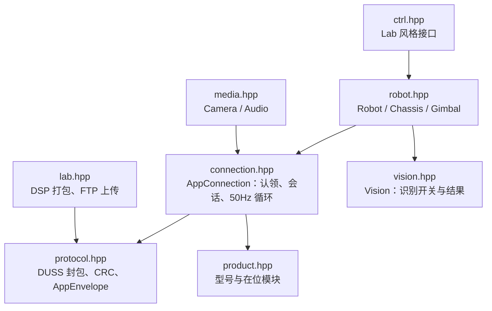

# Hanppie C++ SDK

`src/hanppie` Python 直控库的 C++11 移植：走 RoboMaster S1 出厂开放的 App 协议端口，提供 AppID 认领、App 会话、50 Hz 控制循环、底盘/云台/灯效/音效控制、遥测、音视频流和 Lab 脚本上传。协议行为与 Python 版逐项对应，Python 版是唯一参考实现；两者不互相依赖。

当前版本 **0.0.1**（`HANPPIE_VERSION`，定义在 `include/hanppie/hanppie.hpp`，CMake 项目版本从这里读取）。

> 当前状态：离线单测和本机回环集成测试通过，控制报文与 Python 版逐字节比对一致；**尚未连接实机验证**。

## 与 Python 版的范围差异

| 能力 | Python `hanppie` | C++ SDK |
| --- | --- | --- |
| 协议、会话、控制、遥测、Lab 上传 | 支持 | 支持，API 一一对应 |
| 视频 | 内置 PyAV 解码为帧 | 输出原始 H.264 分片（`Camera::readVideoChunk`），解码交给调用方 |
| 机身麦克风 | 解码为 48 kHz PCM | 输出 Opus 包（`Camera::readAudioOpus`） |
| 扬声器播放 | 输入 12 kHz PCM，内部编码 Opus | 输入已编码的 Opus 包（`media::packOpusPackets` + `Audio::playOpus`） |
| 平台 | 跨平台 | Linux / macOS（POSIX socket）、Windows（Winsock，Vista 及以上） |
| 水弹发射、底盘姿态遥测 | 无 | 有，移植自 App（`robot-core`）中已在 S1 验证的指令与订阅 |
| 视觉识别、SD 卡录像 | 无 | 有，移植自 App（`robot-core` 的 `vision/`、`media/RobotCameraService.kt`），见下文 |
| Lab 风格高层接口 | 无 | `hanppie/ctrl.hpp`，见下文 |

编解码不内置是为了保持零第三方依赖；需要时可用 FFmpeg 或 libopus 处理上述原始数据。

## 构建与测试

需要 CMake 3.10+ 和支持 C++11 的编译器，无其他依赖。

```bash
cmake -S cpp -B cpp/build
cmake --build cpp/build
ctest --test-dir cpp/build --output-on-failure
```

Windows 上 Visual Studio 生成器是多配置的，构建和测试需要指定配置：

```bash
cmake --build cpp/build --config Release
ctest --test-dir cpp/build -C Release --output-on-failure
```

Windows 首次运行回环测试或连接机器人时，防火墙可能弹窗询问是否允许程序收发网络数据，需要允许。

也可以在仓库根目录运行 `task cpp:test`。回环测试会在 127.0.0.1 上模拟机器人，需要 45678、56789、10607、10609 端口空闲。

作为子项目引入：

```cmake
add_subdirectory(path/to/hanppie/cpp)
target_link_libraries(your_app PRIVATE hanppie::hanppie)
```

## 用法

```cpp
#include "hanppie/hanppie.hpp"

hanppie::Robot robot("192.168.1.100", "0123abcd");
robot.initialize();
robot.enterControlMode();
robot.setLed("all", 0, 255, 0);

// 确认地面与射界安全后才允许机械动作。
robot.arm();
robot.chassis.driveSpeed(0.1, 0.0, 0.0, 0.25);  // 250 ms 租约，不续发自动归零
// ...
robot.disarm();
robot.close();  // 析构时也会自动 close
```

完整示例见 [`examples/drive.cpp`](examples/drive.cpp)（驾驶）、[`examples/lab.cpp`](examples/lab.cpp)（打包并上传 Lab 脚本）和下文的编程挑战卡示例。安全规则与 Python 版相同：未 `arm()` 时运动指令抛异常；速度和云台指令带租约，到期自动归零。机器人同一时间只接受一个控制端。

## Lab 风格接口

`hanppie/ctrl.hpp` 提供与 S1 机内 Lab 脚本同名、同参数的控制接口，程序在电脑上运行，通过 App 协议远程控制，不上传脚本。命名、参数顺序、单位和取值范围以仓库内的 S1 机内 Lab 运行时源码（`assets/s1-system/data/dji_scratch/src/robomaster/rm_ctrl.py`、`rm_define.py`）为准，因此刻意保留 Lab 的下划线命名，Lab 脚本基本可以逐行改写：

```cpp
#include "hanppie/hanppie.hpp"
using namespace hanppie::ctrl;

hanppie::Robot robot("192.168.2.1", "0123abcd");
robot.initialize();
{
    RobotCtrl rm(robot);  // 进入遥控模式并 arm；析构时停车、disarm、退出遥控模式
    rm.chassis_ctrl.set_trans_speed(0.5);
    rm.chassis_ctrl.move_with_time(0, 2);                       // 向前 2 秒
    rm.chassis_ctrl.rotate_with_degree(rm_define::clockwise, 90);
    rm.gimbal_ctrl.angle_ctrl(30, 10);                          // 偏航 30°、俯仰 10°
    rm.led_ctrl.set_top_led(rm_define::armor_all, 255, 0, 0, rm_define::effect_breath);
    rm.gun_ctrl.fire_once();                                    // 水弹
    rm.media_ctrl.play_sound(rm_define::media_sound_shoot);
    rm.vision_ctrl.enable_detection(rm_define::vision_detection_marker);
    rm.vision_ctrl.cond_wait_marker(rm_define::marker_trans_red_heart);  // 等到看见红心
    rm.vision_ctrl.detect_marker_and_aim(rm_define::marker_trans_red_heart);
    rm.media_ctrl.record(rm_define::record_on);                 // SD 卡录像
    RobotCtrl::sleep(1);
}
```

| 控制器 | 接口 |
| --- | --- |
| `chassis_ctrl` | `set_trans_speed`、`set_rotate_speed`、`move`、`move_with_time`、`move_with_distance`、`move_with_speed`、`rotate`、`rotate_with_speed`、`rotate_with_time`、`rotate_with_degree`、`move_and_rotate`、`stop`、`get_attitude` |
| `gimbal_ctrl` | `set_rotate_speed`、`rotate`、`rotate_with_speed`、`rotate_with_degree`、`yaw_ctrl`、`pitch_ctrl`、`angle_ctrl`、`recenter`、`stop`、`get_axis_angle` |
| `led_ctrl` | `set_top_led`、`set_bottom_led`、`turn_off`、`gun_led_on`、`gun_led_off` |
| `gun_ctrl` / `ir_blaster_ctrl` | `fire_once`（水弹 / 红外） |
| `media_ctrl` | `play_sound`、`capture`、`record` |
| `vision_ctrl` | `enable_detection`、`disable_detection`、`get_marker_detection_info`、`get_pose_detection_info`、`get_people_detection_info`、`get_line_detection_info`、`detect_marker_and_aim`；Lab 的 `cond_wait` / `check_condition` 对应 `cond_wait_marker`、`cond_wait_pose`、`cond_wait_people`、`check_marker`、`check_pose`、`check_people` |

与机内 Lab 的差异（远程运行导致）：

- **转角度是电脑端闭环**：`rotate_with_degree`、`yaw_ctrl`、`pitch_ctrl`、`angle_ctrl`、`recenter` 根据 10 Hz 的云台遥测和底盘姿态遥测调整转速，增益与容差沿用 App 已验证的云台回中逻辑（每度 3°/s，容差 1°）。遥测中断超过 0.5 秒即停止并抛异常。
- **`move_with_distance` 是开环估算**：App 会话里没有经过验证的位置数据，按「距离 ÷ 速度」计时运行，误差明显大于 Lab。Lab 使用机内位置指令，该指令能否经 App 协议下发需要实机抓包确认。
- **速度上限更低**：App 控制帧限制底盘 1 m/s、150°/s，云台 120°/s；超过的 Lab 取值会被截断，超出 Lab 自身范围的取值抛 `std::invalid_argument`。
- **持续动作由后台线程续发**：`move`、`rotate` 等持续动作在 `RobotCtrl` 内每 50 ms 续租一次，直到 `stop()` 或析构；程序崩溃或断连时仍由 SDK 的 250 ms 租约归零。
- **视觉识别在机器人里做，反应在电脑上做**：识别结果由机器人推送给电脑，`cond_wait_*`、`check_*` 和 `detect_marker_and_aim` 在电脑上判断，反应会多一个 Wi-Fi 往返的延迟。同一时间只开一种识别（与 App 一致），`enable_detection` 换一种识别时会先关掉当前的；如果机器人上已有别的程序开着识别，启动会失败而不会强行关掉它。超过 1 秒没有新结果视为没识别到。
- **`detect_marker_and_aim` 是电脑端闭环**：视场换算（96° × 54°，瞄准点 0.5, 0.53）、容差 1° 和 5 秒时限照搬机内 Lab，转速沿用上面的云台增益，只在收到新的识别结果时调整。
- **录像**：`record(record_on)` 需要最近 1.5 秒内的相机状态显示 SD 卡可用，会先切到录像模式，再等相机状态确认开始录像；`record_off` 等状态确认停止。`capture` 在相机处于录像模式时会先切回拍照模式。
- 不支持的识别：Lab 的自动瞄准（`vision_detection_auto_aim`，在机器人上会接管云台）、行人跟随和机器人识别。
- 尚未提供：装甲命中、拍手等事件回调，自由模式，跑马灯和单灯效果。

标签编号（红心 8、骰子 2、箭头 4–7、数字 10–19、字母 20–45）和姿态编号取自机内 Lab 源码 `rm_define.py`，机内 Lab 和 App 读的是同一条识别推送；其中数字和字母编号与 App 客户端的定义一致；所有编号都还没有实机确认。

以上闭环与识别逻辑只在本机回环测试中用模拟机器人验证过，**未连接实机**。

## 编程挑战卡示例

[`examples/challenges.cpp`](examples/challenges.cpp) 用 Lab 风格接口实现了官方《RoboMaster S1 编程挑战卡》中目前能做的 22 张，按卡号运行：

```bash
cpp/build/hanppie_challenges --list                      # 列出可运行的卡片
cpp/build/hanppie_challenges 192.168.2.1 0123abcd 6      # 运行第 6 张「瞄准红心」
```

| 类别 | 卡号 |
| --- | --- |
| 底盘 | 1 走个正方形、2 十字走位、13「8」字形运动、19 S1 向左转、25 S 形倒退、29 加速前进 |
| 云台与发射 | 4 能歌善舞、9 回马枪、10 环绕扫射、14 云台传感器、16 体感控制、21 阅兵 |
| 多媒体 | 11 摄像师 S1、17 弹钢琴、18 算数学题、23 十连拍 |
| 视觉识别 | 6 瞄准红心、15 手势拍照、22 视野跟随、24 视力测试、27 摇骰子、28 标签演奏会 |

与卡片原题的差别：

- 第 16 张原题用手机陀螺仪，电脑上改为从终端输入偏航、俯仰角度，也可以换成手柄等输入源。
- 发射默认用红外（第 6、9、10 张），改成 `gun_ctrl.fire_once()` 即发射水弹。
- 第 1、2 张的移动距离是按时间估算的，边长会有误差。

剩下 8 张（3、5、7、8、12、20、26、30）需要自由模式、拍手/撞击/装甲命中事件、跑马灯或单灯控制，这些指令尚未经过 App 协议的抓包验证，暂不提供。

## 模块对应



| Python | C++ |
| --- | --- |
| `hanppie.protocol` | `hanppie/protocol.hpp`（`hanppie::protocol`） |
| `hanppie.product` | `hanppie/product.hpp` |
| `hanppie.connection.AppConnection` | `hanppie::AppConnection`；`on("duss"/"video"/"audio"/"product")` 对应 `onDuss/onVideo/onAudio/onProduct` |
| `hanppie.robot.Robot` | `hanppie::Robot`；方法名改为驼峰，关键字参数改为位置参数 |
| `hanppie.media.Camera` / `Audio` | `hanppie::media::Camera` / `Audio` |
| `hanppie.lab` | `hanppie/lab.hpp` |

可选返回值（Python 的 `None`）在 C++ 中统一为 `bool` 返回值加输出参数；超时抛 `hanppie::TimeoutError`，设备拒绝抛 `hanppie::RequestRejected`（均派生自 `std::runtime_error`）。

## 与 Python 版保持同步

抓包得来的固定序列和载荷编码以 Python 版为准。`tests/golden_vectors.inc` 由 Python 版生成，修改 `src/hanppie` 的协议或载荷后重新生成并跑测试：

```bash
uv run python cpp/tests/generate_golden.py > cpp/tests/golden_vectors.inc
```
