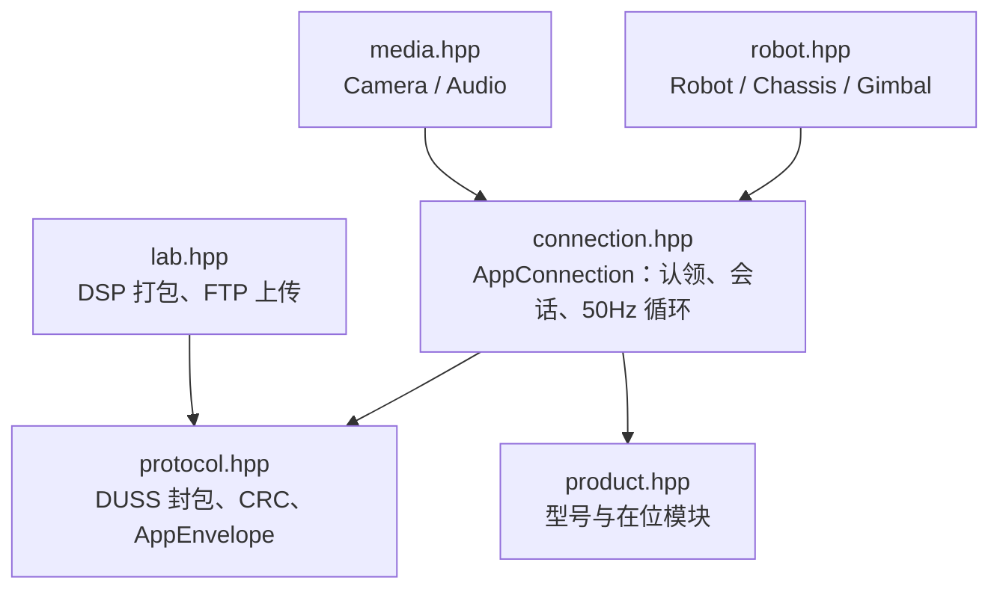

# Hanppie C++ SDK

`src/hanppie` Python 直控库的 C++11 移植：走 RoboMaster S1 出厂开放的 App 协议端口，提供 AppID 认领、App 会话、50 Hz 控制循环、底盘/云台/灯效/音效控制、遥测、音视频流和 Lab 脚本上传。协议行为与 Python 版逐项对应，Python 版是唯一参考实现；两者不互相依赖。

> 当前状态：离线单测和本机回环集成测试通过，控制报文与 Python 版逐字节比对一致；**尚未连接实机验证**。

## 与 Python 版的范围差异

| 能力 | Python `hanppie` | C++ SDK |
| --- | --- | --- |
| 协议、会话、控制、遥测、Lab 上传 | 支持 | 支持，API 一一对应 |
| 视频 | 内置 PyAV 解码为帧 | 输出原始 H.264 分片（`Camera::readVideoChunk`），解码交给调用方 |
| 机身麦克风 | 解码为 48 kHz PCM | 输出 Opus 包（`Camera::readAudioOpus`） |
| 扬声器播放 | 输入 12 kHz PCM，内部编码 Opus | 输入已编码的 Opus 包（`media::packOpusPackets` + `Audio::playOpus`） |
| 平台 | 跨平台 | Linux / macOS（POSIX socket），暂不支持 Windows |

编解码不内置是为了保持零第三方依赖；需要时可用 FFmpeg 或 libopus 处理上述原始数据。

## 构建与测试

需要 CMake 3.10+ 和支持 C++11 的编译器，无其他依赖。

```bash
cmake -S cpp -B cpp/build
cmake --build cpp/build
ctest --test-dir cpp/build --output-on-failure
```

也可以在仓库根目录运行 `task cpp:test`。回环测试会在 127.0.0.1 上模拟机器人，需要 45678、56789、10607、10609 端口空闲。

作为子项目引入：

```cmake
add_subdirectory(path/to/hanppie/cpp)
target_link_libraries(your_app PRIVATE hanppie::hanppie)
```

## 用法

```cpp
#include "hanppie/hanppie.hpp"

hanppie::Robot robot("192.168.1.100", "0123abcd");
robot.initialize();
robot.enterControlMode();
robot.setLed("all", 0, 255, 0);

// 确认地面与射界安全后才允许机械动作。
robot.arm();
robot.chassis.driveSpeed(0.1, 0.0, 0.0, 0.25);  // 250 ms 租约，不续发自动归零
// ...
robot.disarm();
robot.close();  // 析构时也会自动 close
```

完整示例见 [`examples/drive.cpp`](examples/drive.cpp)（驾驶）和 [`examples/lab.cpp`](examples/lab.cpp)（打包并上传 Lab 脚本）。安全规则与 Python 版相同：未 `arm()` 时运动指令抛异常；速度和云台指令带租约，到期自动归零。机器人同一时间只接受一个控制端。

## 模块对应



| Python | C++ |
| --- | --- |
| `hanppie.protocol` | `hanppie/protocol.hpp`（`hanppie::protocol`） |
| `hanppie.product` | `hanppie/product.hpp` |
| `hanppie.connection.AppConnection` | `hanppie::AppConnection`；`on("duss"/"video"/"audio"/"product")` 对应 `onDuss/onVideo/onAudio/onProduct` |
| `hanppie.robot.Robot` | `hanppie::Robot`；方法名改为驼峰，关键字参数改为位置参数 |
| `hanppie.media.Camera` / `Audio` | `hanppie::media::Camera` / `Audio` |
| `hanppie.lab` | `hanppie/lab.hpp` |

可选返回值（Python 的 `None`）在 C++ 中统一为 `bool` 返回值加输出参数；超时抛 `hanppie::TimeoutError`，设备拒绝抛 `hanppie::RequestRejected`（均派生自 `std::runtime_error`）。

## 与 Python 版保持同步

抓包得来的固定序列和载荷编码以 Python 版为准。`tests/golden_vectors.inc` 由 Python 版生成，修改 `src/hanppie` 的协议或载荷后重新生成并跑测试：

```bash
uv run python cpp/tests/generate_golden.py > cpp/tests/golden_vectors.inc
```
