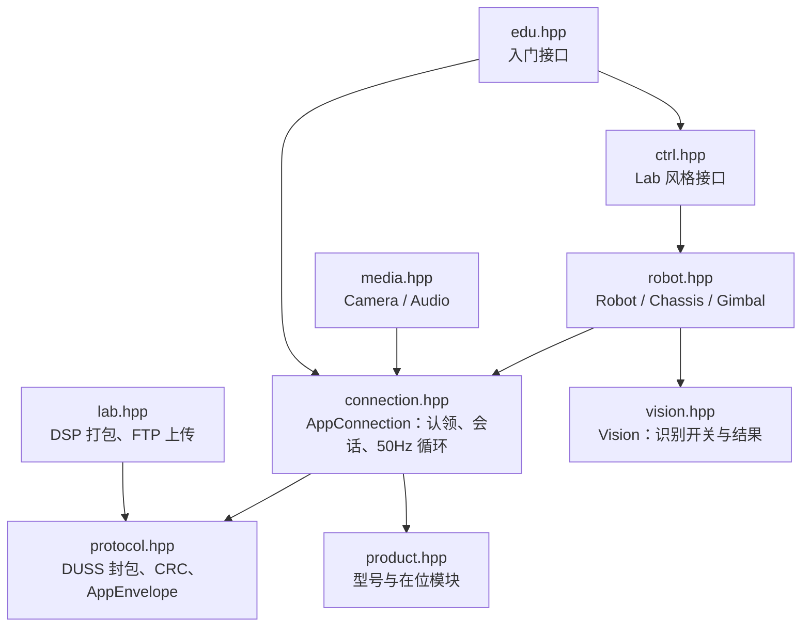

# Hanppie C++ SDK

`src/hanppie` Python 直控库的 C++11 移植：走 RoboMaster S1 出厂开放的 App 协议端口，提供 AppID 认领、App 会话、50 Hz 控制循环、底盘/云台/灯效/音效控制、遥测、音视频流和 Lab 脚本上传。连接序列、遥控模式进出表和灯效载荷与 Python 版逐字节比对；底盘和云台的运动路径以已在实机验证的 App（`packages/robot-core`）为准，与 Python 版不同，见下文「运动与安全」。两者不互相依赖。

当前版本 **0.0.8**（`HANPPIE_VERSION`，定义在 `include/hanppie/hanppie.hpp`，CMake 项目版本从这里读取）。

> 当前状态：离线单测和本机回环集成测试通过。运动指令载荷与 App 的测试向量逐字节一致，遥控模式进出表与 App 逐行核对一致。App 本身经过实机验证，但这份 C++ 实现的运动路径**尚未连接实机验证**。

## 与 Python 版的范围差异

| 能力 | Python `hanppie` | C++ SDK |
| --- | --- | --- |
| 协议、会话、控制、遥测、Lab 上传 | 支持 | 支持，API 一一对应 |
| 底盘与云台运动 | 底盘走控制帧的摇杆载荷，云台走 `04:69` | 与 App 一致，不沿用 Python 版的路径；没有 `drive_wheels`（独立轮速） |
| 视频 | 内置 PyAV 解码为帧 | 输出原始 H.264 分片（`Camera::readVideoChunk`），解码交给调用方 |
| 机身麦克风 | 解码为 48 kHz PCM | 输出 Opus 包（`Camera::readAudioOpus`） |
| 扬声器播放 | 输入 12 kHz PCM，内部编码 Opus | 输入已编码的 Opus 包（`media::packOpusPackets` + `Audio::playOpus`） |
| 平台 | 跨平台 | Linux / macOS（POSIX socket）、Windows（Winsock，Vista 及以上）；另有单头文件版，支持 Dev-C++ 5.11 |
| 水弹发射、底盘姿态遥测 | 无 | 有，移植自 App（`robot-core`）中已在 S1 验证的指令与订阅 |
| 视觉识别、SD 卡录像 | 无 | 有，移植自 App（`robot-core` 的 `vision/`、`media/RobotCameraService.kt`），见下文 |
| Lab 风格高层接口 | 无 | `hanppie/ctrl.hpp`，见下文 |
| 入门接口 | 无 | `hanppie/edu.hpp`，见下文 |

编解码不内置是为了保持零第三方依赖；需要时可用 FFmpeg 或 libopus 处理上述原始数据。

## 构建与测试

需要 CMake 3.10+ 和支持 C++11 的编译器，无其他依赖。

```bash
cmake -S cpp -B cpp/build
cmake --build cpp/build
ctest --test-dir cpp/build --output-on-failure
```

Windows 上 Visual Studio 生成器是多配置的，构建和测试需要指定配置：

```bash
cmake --build cpp/build --config Release
ctest --test-dir cpp/build -C Release --output-on-failure
```

Windows 首次运行回环测试或连接机器人时，防火墙可能弹窗询问是否允许程序收发网络数据，需要允许。

也可以在仓库根目录运行 `task cpp:test`。回环测试会在 127.0.0.1 上模拟机器人，需要 45678、56789、10607、10609 端口空闲。

作为子项目引入：

```cmake
add_subdirectory(path/to/hanppie/cpp)
target_link_libraries(your_app PRIVATE hanppie::hanppie)
```

## 单头文件版（Dev-C++ 与在线评测）

Dev-C++ 和在线评测系统只编译一个源文件，不能加链接选项。为此 SDK 另外提供单头文件 `hanppie.h`，包含全部头文件和实现。每个 Release 都附带这个文件，也可以从源码生成：

```bash
python3 cpp/tools/amalgamate.py hanppie.h
```

把 `hanppie.h` 放在源文件旁边，只在**一个** `.cpp` 文件里包含它：

```cpp
#include "hanppie.h"
using namespace hanppie::edu;

int main() {
    if (!connect()) return 1;
    forward(1);
    beep();
    disconnect();
    return 0;
}
```

| 环境 | 编译方式 |
| --- | --- |
| Windows，Dev-C++ 5.11（TDM-GCC 4.9.2，64 位） | 编译选项 `-O2 -std=c++11`（评测环境另加 `-DONLINE_JUDGE`），不需要其他链接选项 |
| macOS | `clang++ -O2 -std=c++11 main.cpp -o main` |
| Linux | `g++ -O2 -std=c++11 main.cpp -o main`，glibc 2.34 以前的系统需要加 `-pthread` |

Windows 上网络库 `ws2_32.dll` 在程序运行时自动加载，所以不需要 `-lws2_32`；CMake 构建也一样。CI 用 Dev-C++ 5.11 安装包里的 TDM-GCC 4.9.2 以 `-O2` 编译并运行全部测试，并在 Windows、macOS、Linux 上按上面的方式编译检查单头文件（`tests/single_header.cpp`）。

## 入门接口（`hanppie::edu`）

面向刚学 C++ 的孩子（例如在 Dev-C++ 中准备 GESP），只用函数、变量、条件和循环就能控制机器人，不需要了解网络地址、线程、速度续发和异常：

```cpp
#include "hanppie.h"
using namespace hanppie::edu;

int main() {
    if (!connect()) return 1;
    for (int i = 0; i < 3; i++) {
        forward(1);  // 低速前进 1 秒，结束自动停车
        beep();
    }
    disconnect();
}
```

| 函数 | 作用 |
| --- | --- |
| `connect()` / `disconnect()` / `connected()` | 自动找到机器人并连接 / 停车并断开 / 是否已连接 |
| `forward(秒)` / `backward(秒)` | 前进 / 后退，0.3 m/s |
| `left(秒)` / `right(秒)` | 向左 / 向右平移，不转向 |
| `turnLeft(度)` / `turnRight(度)` | 原地左转 / 右转，60°/s |
| `stop()` / `beep()` / `wait(秒)` | 停车 / 响一声 / 程序暂停 |

- **零配置连接**：`connect()` 监听机器人在局域网里的状态广播（UDP 45678），用广播中的地址和机器人已绑定的 AppID 连接，程序里不出现 IP 和 AppID，AppID 只留在内存中。机器人未绑定时随机生成一个。官方 App 的自动连接和 2026-11-06 的 S1 实机操作都用的是广播里的 AppID；已被其他程序连接的机器人可能不广播，此时会提示关闭其他控制程序后重试。
- **安全边界**：速度固定为低速；单次移动和等待不超过 10 秒，单次转向不超过 360°，超出范围的调用不执行；每个动作结束、出错或程序正常结束时都会停车。Windows 上关闭控制台窗口或按 Ctrl+C 时会尽量先停车，但这只是尽力而为：用任务管理器强制结束或断电时无法保证，机器人失去指令后的行为尚未实机验证。
- **出错不抛异常**：函数返回 `false` 并在窗口打印一行英文提示（Dev-C++ 控制台使用系统代码页，中文提示会乱码）。
- 距离与角度：移动按时间计算，不承诺精确距离；转向按机器人回传的姿态闭环控制。
- 样例：[`examples/edu.cpp`](examples/edu.cpp)，构建后运行 `cpp/build/hanppie_edu`，不需要参数。

以上只在模拟机器人上测试过，**尚未连接实机**。

## 对外接口

应用程序和样例只使用两套接口：

| 接口 | 适合 | 入口 |
| --- | --- | --- |
| 入门接口 `hanppie::edu` | 刚学 C++ 的孩子 | `connect()` 后调用 `forward(1)`、`turnLeft(90)` 等函数，见上文 |
| Lab 风格接口 `hanppie::ctrl` | 熟悉 S1 Lab 或需要完整功能 | `RobotCtrl rm;` 后调用 `rm.chassis_ctrl.move_with_time(0, 2)` 等，见下文 |

`Robot`、`AppConnection`、`media::Camera` 等底层类是这两套接口的实现，保持公开以便测试和扩展，但样例和接入文档不再直接调用。两套接口都没有覆盖的能力只有视频/音频流（`rm.robot.camera`）和 Lab 脚本上传（`hanppie/lab.hpp`，样例 [`examples/lab.cpp`](examples/lab.cpp)）。机器人同一时间只接受一个控制端。

## 运动与安全

本节说明两套接口共用的底层机制：入门接口和 Lab 风格接口都在此基础上自动续发、自动停车。底盘和云台的运动指令、遥控模式切换和持续发送方式与 App 一致，协议细节见[遥控操纵与安全联动](../docs/architecture/hanppie.md#134-遥控操纵镜头坐标系与安全联动)：

- `enterControlMode()` 走完 App 的遥控模式进入序列，随后底盘和云台以 50 Hz 持续发送零速保持；`exitControlMode()` 先停车再退出，之后不再发送运动指令。没有进入遥控模式时，运动指令不会下发。
- `chassis.driveSpeed(x, y, z, leaseSeconds)` 和 `gimbal.driveSpeed(pitch, yaw, leaseSeconds)` 在租约期内持续发送该速度，到期回到零速保持，默认租约 250 ms；底盘速度全为零（包括 `-0.0`）时等同 `stop()`。底盘速度单位为 m/s（前、右）和 °/s（顺时针），云台为 °/s。
- 速度超过 App 的上限（底盘 1 m/s、150°/s，云台 120°/s）时被截断，非有限值抛 `std::invalid_argument`；没有 `arm()` 时抛 `std::runtime_error`。
- `robot.stop()` 同时停底盘和云台，并取消尚未结束的红外发射；`disarm()` 也会调用它。
- `disarm()` 和运动指令互斥：`disarm()` 返回后，其他线程不会再让机器人动起来。
- 与 App 相同，超过 500 ms 没有收到机器人的任何数据时，运动和红外指令会先停下底盘和云台，再抛 `std::runtime_error`；重新收到数据后可以继续下发。`RobotCtrl` 的后台续发线程因此也会在失联 500 ms 内停车。

租约、零速保持和停车都由电脑端的进程执行。进程被强杀、断网或断电时，电脑不再发送任何指令，机器人是否会在运动中自行停下取决于固件，**没有经过实机验证**；实机运行时应留人在旁，随时可以切断电源。

## Lab 风格接口

`hanppie/ctrl.hpp` 提供与 S1 机内 Lab 脚本同名、同参数的控制接口，程序在电脑上运行，通过 App 协议远程控制，不上传脚本。命名、参数顺序、单位和取值范围以仓库内的 S1 机内 Lab 运行时源码（`assets/s1-system/data/dji_scratch/src/robomaster/rm_ctrl.py`、`rm_define.py`）为准，因此刻意保留 Lab 的下划线命名，Lab 脚本基本可以逐行改写：

```cpp
#include "hanppie/hanppie.hpp"
using namespace hanppie::ctrl;

{
    RobotCtrl rm;  // 自动找到机器人，进入遥控模式并 arm；析构时停车、退出遥控模式并断开
    rm.chassis_ctrl.set_trans_speed(0.5);
    rm.chassis_ctrl.move_with_time(0, 2);                       // 向前 2 秒
    rm.chassis_ctrl.rotate_with_degree(rm_define::clockwise, 90);
    rm.gimbal_ctrl.angle_ctrl(30, 10);                          // 偏航 30°、俯仰 10°
    rm.led_ctrl.set_top_led(rm_define::armor_all, 255, 0, 0, rm_define::effect_breath);
    rm.gun_ctrl.fire_once();                                    // 水弹
    rm.media_ctrl.play_sound(rm_define::media_sound_shoot);
    rm.vision_ctrl.enable_detection(rm_define::vision_detection_marker);
    rm.vision_ctrl.cond_wait_marker(rm_define::marker_trans_red_heart);  // 等到看见红心
    rm.vision_ctrl.detect_marker_and_aim(rm_define::marker_trans_red_heart);
    rm.media_ctrl.record(rm_define::record_on);                 // SD 卡录像
    RobotCtrl::sleep(1);
}
```

`RobotCtrl rm;` 从机器人的局域网广播里取地址和已绑定的 AppID 自动连接；也可以写 `RobotCtrl rm("192.168.2.1", "0123abcd");` 指定地址和 AppID。离开作用域时停车、退出遥控模式并断开。

| 控制器 | 接口 |
| --- | --- |
| `chassis_ctrl` | `set_trans_speed`、`set_rotate_speed`、`move`、`move_with_time`、`move_with_distance`、`move_with_speed`、`rotate`、`rotate_with_speed`、`rotate_with_time`、`rotate_with_degree`、`move_and_rotate`、`stop`、`get_attitude` |
| `gimbal_ctrl` | `set_rotate_speed`、`rotate`、`rotate_with_speed`、`rotate_with_degree`、`yaw_ctrl`、`pitch_ctrl`、`angle_ctrl`、`recenter`、`stop`、`get_axis_angle` |
| `led_ctrl` | `set_led`、`set_top_led`、`set_bottom_led`、`turn_off`、`gun_led_on`、`gun_led_off` |
| `gun_ctrl` / `ir_blaster_ctrl` | `fire_once`（水弹 / 红外） |
| `media_ctrl` | `play_sound`、`capture`、`record`；C++ 新增 `play_opus`（通过扬声器播放 Opus 音频，单次不超过 64 KB） |
| `vision_ctrl` | `enable_detection`、`disable_detection`、`get_marker_detection_info`、`get_pose_detection_info`、`get_people_detection_info`、`get_line_detection_info`、`detect_marker_and_aim`；Lab 的 `cond_wait` / `check_condition` 对应 `cond_wait_marker`、`cond_wait_pose`、`cond_wait_people`、`check_marker`、`check_pose`、`check_people` |

与机内 Lab 的差异（远程运行导致）：

- **转角度是电脑端闭环**：`rotate_with_degree`、`yaw_ctrl`、`pitch_ctrl`、`angle_ctrl`、`recenter` 根据 10 Hz 的云台遥测和底盘姿态遥测调整转速，增益与容差沿用 App 已验证的云台回中逻辑（每度 3°/s，容差 1°）。遥测中断超过 0.5 秒即停止并抛异常。
- **`move_with_distance` 是开环估算**：App 会话里没有经过验证的位置数据，按「距离 ÷ 速度」计时运行，误差明显大于 Lab。Lab 使用机内位置指令，该指令能否经 App 协议下发需要实机抓包确认。
- **速度上限更低**：App 的遥控指令限制底盘 1 m/s、150°/s，云台 120°/s；超过的 Lab 取值会被截断，超出 Lab 自身范围的取值抛 `std::invalid_argument`。
- **持续动作由后台线程续发**：`move`、`rotate` 等持续动作在 `RobotCtrl` 内每 50 ms 续租一次，直到 `stop()` 或析构；续租停止后 250 ms 租约到期，回到零速保持。进程被强杀或断网时的行为见上文「运动与安全」。
- **视觉识别在机器人里做，反应在电脑上做**：识别结果由机器人推送给电脑，`cond_wait_*`、`check_*` 和 `detect_marker_and_aim` 在电脑上判断，反应会多一个 Wi-Fi 往返的延迟。同一时间只开一种识别（与 App 一致），`enable_detection` 换一种识别时会先关掉当前的；如果机器人上已有别的程序开着识别，启动会失败而不会强行关掉它。超过 1 秒没有新结果视为没识别到。
- **`detect_marker_and_aim` 是电脑端闭环**：视场换算（96° × 54°，瞄准点 0.5, 0.53）、容差 1° 和 5 秒时限照搬机内 Lab，转速沿用上面的云台增益，只在收到新的识别结果时调整。
- **录像**：`record(record_on)` 需要最近 1.5 秒内的相机状态显示 SD 卡可用，会先切到录像模式，再等相机状态确认开始录像；`record_off` 等状态确认停止。`capture` 在相机处于录像模式时会先切回拍照模式。
- 不支持的识别：Lab 的自动瞄准（`vision_detection_auto_aim`，在机器人上会接管云台）、行人跟随和机器人识别。
- 尚未提供：装甲命中、拍手等事件回调，自由模式，云台正弦摆动（`compound_motion_ctrl`），跑马灯和单灯效果。

标签编号（红心 8、骰子 2、箭头 4–7、数字 10–19、字母 20–45）和姿态编号取自机内 Lab 源码 `rm_define.py`，机内 Lab 和 App 读的是同一条识别推送；其中数字和字母编号与 App 客户端的定义一致；所有编号都还没有实机确认。

以上闭环与识别逻辑只在本机回环测试中用模拟机器人验证过，**未连接实机**。

## 编程挑战卡示例

[`examples/challenges.cpp`](examples/challenges.cpp) 用 Lab 风格接口实现了官方《RoboMaster S1 编程挑战卡》中目前能做的 22 张，按卡号运行：

```bash
cpp/build/hanppie_challenges --list                      # 列出可运行的卡片
cpp/build/hanppie_challenges 192.168.2.1 0123abcd 6      # 运行第 6 张「瞄准红心」
```

| 类别 | 卡号 |
| --- | --- |
| 底盘 | 1 走个正方形、2 十字走位、13「8」字形运动、19 S1 向左转、25 S 形倒退、29 加速前进 |
| 云台与发射 | 4 能歌善舞、9 回马枪、10 环绕扫射、14 云台传感器、16 体感控制、21 阅兵 |
| 多媒体 | 11 摄像师 S1、17 弹钢琴、18 算数学题、23 十连拍 |
| 视觉识别 | 6 瞄准红心、15 手势拍照、22 视野跟随、24 视力测试、27 摇骰子、28 标签演奏会 |

与卡片原题的差别：

- 第 16 张原题用手机陀螺仪，电脑上改为从终端输入偏航、俯仰角度，也可以换成手柄等输入源。
- 发射默认用红外（第 6、9、10 张），改成 `gun_ctrl.fire_once()` 即发射水弹。
- 第 1、2 张的移动距离是按时间估算的，边长会有误差。

剩下 8 张（3、5、7、8、12、20、26、30）需要自由模式、拍手/撞击/装甲命中事件、跑马灯或单灯控制，这些指令尚未经过 App 协议的抓包验证，暂不提供。

## 预置脚本示例

[`examples/presets.cpp`](examples/presets.cpp) 把 App 自带的 12 个预置脚本（`shared/src/commonMain/composeResources/files/presets/`）逐步改写成 C++，动作、灯色、音符和时长与原脚本一致，按脚本目录名运行：

```bash
cpp/build/hanppie_presets --list                                  # 列出全部预置脚本
cpp/build/hanppie_presets 192.168.2.1 0123abcd bomb_squad         # 运行「拆弹倒计时」
cpp/build/hanppie_presets 192.168.2.1 0123abcd friday_disco \
  shared/src/commonMain/composeResources/files/presets/friday_disco/audio/0_friday_night.opus
```

与原脚本的差别：

- 原脚本开头切到自由模式（云台和底盘各自转动），C++ 没有对应指令，在 App 遥控模式下运行；云台转动时底盘是否跟随需要实机确认。
- 「周五狂欢舞」的跑马灯改为闪烁。背景音乐要传入原脚本的 Opus 文件（仓库用 Git LFS 保存，先 `git lfs pull`），不传则不放音乐。原脚本的音乐随 Lab 脚本一起装到机器人上；这里走扬声器上传，单次最多 64 KB，88 秒的音乐（136 KB）分 3 段依次上传播放，段间有约半秒停顿，后面的动作会和音乐逐渐错开。分段播放尚未在实机上验证。
- 「音乐洒水车」的云台正弦摆动（周期 4.4 秒、左右各 35°）在电脑端按正弦曲线持续调整云台转速来模拟，不如机内执行平滑。
- 「好奇哨兵」最后的提示音原脚本会等播完，这里固定等 1 秒。
- 底盘转速、云台转速超过 App 遥控上限（150°/s、120°/s）的取值会被截断，「周五狂欢舞」的转圈会比原脚本慢。
- 指令经 Wi-Fi 发送，跟着音乐节拍的脚本可能略有不同步。「周五狂欢舞」有约 50 次小角度云台转动，每次都在电脑端按遥测闭环等到位，在模拟机器人上整段约 150 秒，明显长于 88 秒的音乐，实机时长待确认。

12 个示例只在本机用测试里的模拟机器人完整跑过，**未连接实机**。

## 模块对应



| Python | C++ |
| --- | --- |
| `hanppie.protocol` | `hanppie/protocol.hpp`（`hanppie::protocol`） |
| `hanppie.product` | `hanppie/product.hpp` |
| `hanppie.connection.AppConnection` | `hanppie::AppConnection`；`on("duss"/"video"/"audio"/"product")` 对应 `onDuss/onVideo/onAudio/onProduct` |
| `hanppie.robot.Robot` | `hanppie::Robot`；方法名改为驼峰，关键字参数改为位置参数 |
| `hanppie.media.Camera` / `Audio` | `hanppie::media::Camera` / `Audio` |
| `hanppie.lab` | `hanppie/lab.hpp` |

可选返回值（Python 的 `None`）在 C++ 中统一为 `bool` 返回值加输出参数；超时抛 `hanppie::TimeoutError`，设备拒绝抛 `hanppie::RequestRejected`（均派生自 `std::runtime_error`）。

## 与 Python 版和 App 保持同步

连接序列、遥控模式进出表和灯效载荷以 Python 版为参照。`tests/golden_vectors.inc` 由 Python 版生成，修改 `src/hanppie` 的这些协议或载荷后重新生成并跑测试：

```bash
uv run python cpp/tests/generate_golden.py > cpp/tests/golden_vectors.inc
```

遥控模式的效果表和退出表中，C++ 随 App 使用 `0000` flags，Python 版沿用默认 flags；Python 版退出时多发的云台零速（`04:69`）属于它自己的运动路径，生成器不录入。测试对这些行显式使用 App 的 flags，再比对其余字段。

运动指令不在黄金向量里，载荷和发送序列以 App 为准：载荷期望值取自 `packages/robot-core` 的 `RemoteControlTest.kt`，见 `tests/test_main.cpp` 的 `motion_payload_builders_match_the_app`；进入遥控后的发送序列、租约回落和停车见 `tests/test_loopback.cpp` 的 `loopback_session_matches_the_app_flow` 和 `leaving_control_mode_stops_motion_and_releases_the_slots`。App 的运动路径变化时同步更新这些测试和实现。
